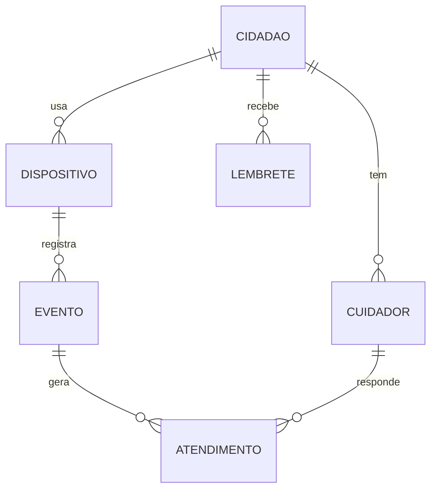

# Amparo API — Global Solution 2026/2 · CitizenTech

API REST da solução **Amparo**, uma rede de cuidado para idosos e pessoas com deficiência:
um dispositivo IoT (ESP32 com botão de emergência e acelerômetro) registra eventos na API,
que aciona os cuidadores cadastrados em ordem de prioridade.

> Status: em desenvolvimento (etapa 1 — modelagem, CRUD, validação e tratamento de erros).

## Integrantes

| Nome | RM | Turma |
|------|----|-------|
| Matheus Carneiro Maciel | 567753 | 2TDSPB |
| _preencher_ | | |

## Como rodar

**Perfil dev (H2 em memória, sem configurar nada):**

```bash
mvn spring-boot:run -Dspring-boot.run.profiles=dev
```

Sobe em `http://localhost:8080` com dados de exemplo (`data.sql`). Console do H2 em `/h2`
(JDBC URL `jdbc:h2:mem:amparo`, usuário `sa`, sem senha).

**Perfil padrão (PostgreSQL):** defina `DB_URL`, `DB_USER` e `DB_PASSWORD` como variáveis de ambiente.

## Como testar

Abra `requests.http` (IntelliJ ou extensão REST Client do VS Code) e execute as requisições em ordem.

## Modelo de domínio



- **Cidadao** — pessoa assistida (idoso ou PcD)
- **Cuidador** — contatos de resposta, com `prioridade` (1 = primeiro a ser acionado)
- **Dispositivo** — ESP32 identificado por `codigoSerial`
- **Evento** — ocorrência enviada pelo dispositivo (`BOTAO_EMERGENCIA`, `QUEDA_DETECTADA`, `BATERIA_BAIXA`)
- **Atendimento** — acionamento de um cuidador para um evento (cascata de escalonamento)
- **Lembrete** — lembretes do cidadão (remédio, consulta)

## Endpoints

| Recurso | Rotas |
|---------|-------|
| `/cidadaos` | GET (paginado), GET /{id}, POST, PUT /{id}, DELETE /{id} |
| `/cuidadores` | idem |
| `/dispositivos` | idem |
| `/eventos` | idem + `PATCH /{id}/status`; o `POST` é o endpoint chamado pelo ESP32 |
| `/atendimentos` | idem |
| `/lembretes` | idem |

Paginação e ordenação: `?page=0&size=10&sort=nome,asc`.

Erros seguem um formato único (`ApiError`): 400 para validação (com lista de campos),
404 para id inexistente, 409 para violação de integridade.

## Uso de IA generativa

_preencher: ferramentas usadas e para quê._
